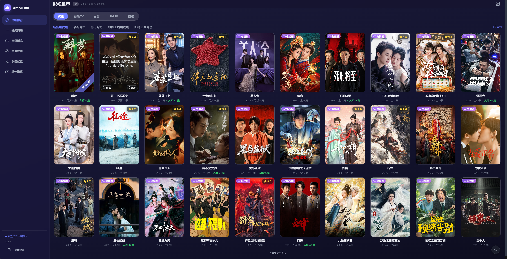
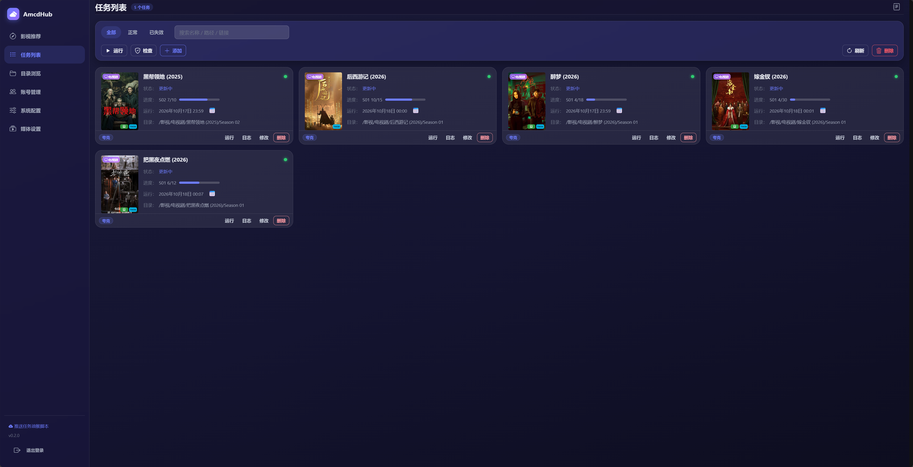
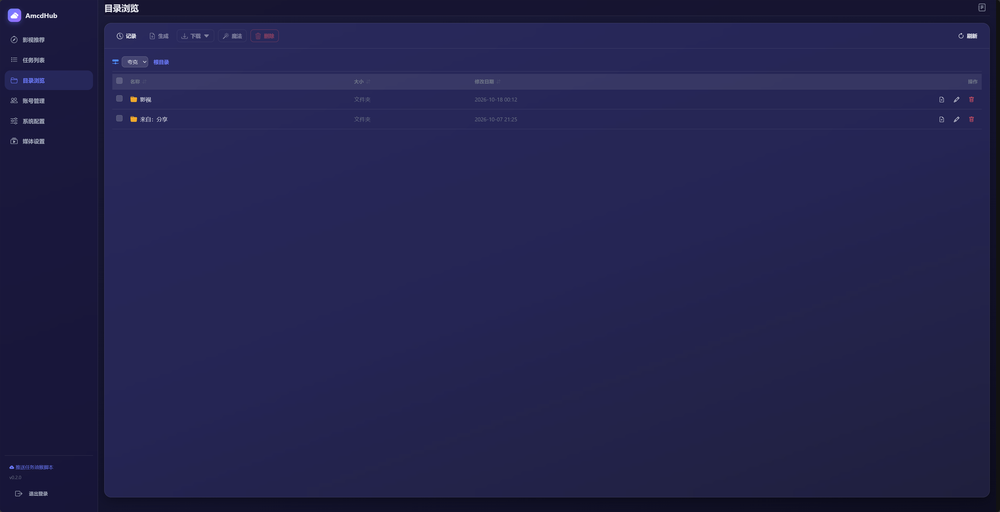
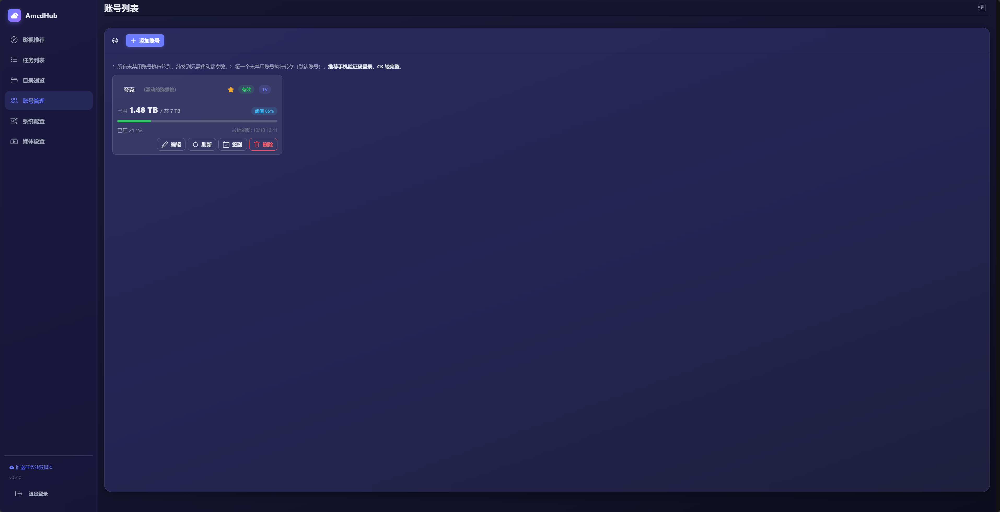
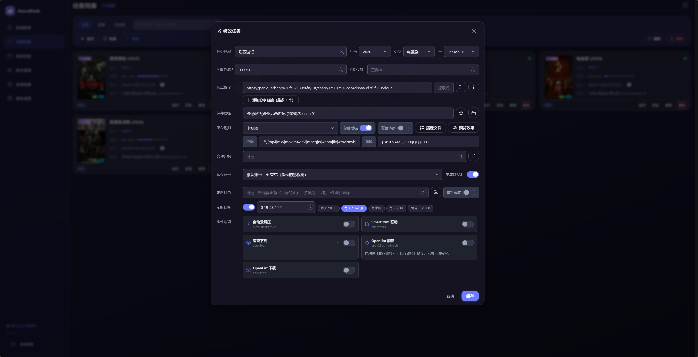
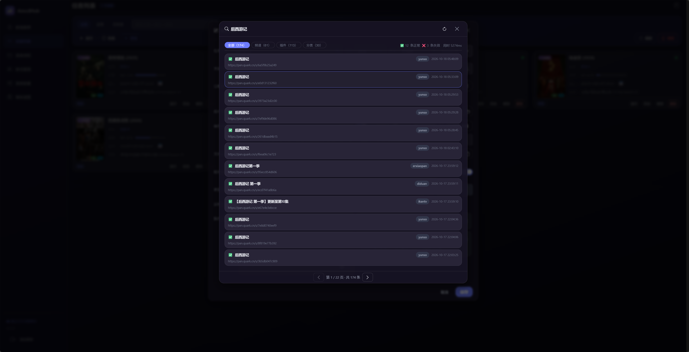
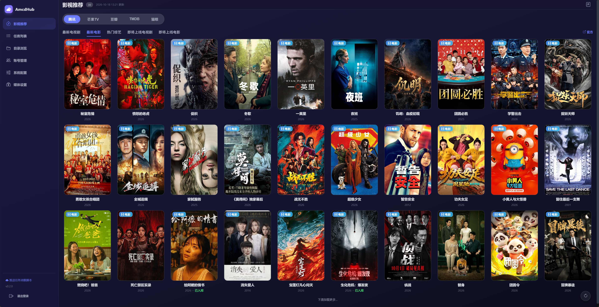

# AmcdHub

聚合影视榜单、编排夸克网盘自动转存与媒体库整理的一站式 WebUI 工具。

> 本仓库为 **发布 / 文档仓库**：仅包含项目说明、Docker 安装方法、鸣谢、项目截图与 Android 客户端安装包（apk）。
> 项目**源代码不在本仓库**中。

---

## 一、项目说明

AmcdHub 是一个自托管的影视资源管理工具，把「找片 → 转存网盘 → 整理成媒体库 → 在 Emby/Jellyfin 观看」整条链路打通，提供统一的中文 Web 界面。

### 主要功能

- **影视推荐看板**
  - 聚合猫眼实时热度、TMDB、豆瓣、腾讯视频等多源榜单
  - 海报一键搜索并直接创建转存任务
  - 点击条目可跳转对应来源官网榜单页
- **任务管理**
  - 多组任务、多账号支持
  - 定时执行（cron / 间隔）与「立即运行」
  - 查看上次执行日志、修改、删除（删除时同步清理封面与日志）
- **网盘转存与整理**
  - 夸克网盘自动转存、子目录、失效分享跳过
  - 魔法匹配 / 魔法变量、正则过滤与重命名
  - 支持需提取码的分享链接
- **媒体库整合**
  - 浏览网盘目录一键生成 `.strm`，配合 Emby / Jellyfin 免下载入库
  - 可选 Emby 302 反向代理（端口 `8099`），直链播放、绕开 CORS
  - 转存 / 整理后自动刷新媒体库
- **追剧日历**：基于 TVmaze 的播出日历，自动识别「今天更新到哪几集」
- **封面工作室**：为媒体库批量生成精美封面
- **其它**
  - 账号管理、系统配置（通知 / 资源搜索 / OpenList / Aria2 / Webhook 等）
  - 多种通知渠道（企业微信等）
  - 油猴脚本「推送任务」一键从分享页添加任务
  - Android 客户端，随时随地管理任务

### 技术栈

| 层 | 技术 |
|---|---|
| 后端 | Python（Flask + APScheduler），Emby 302 代理基于 FastAPI / uvicorn / httpx |
| 前端 | Vue 3 + Vite + Bootstrap Icons + axios |
| 封面生成 | Pillow / numpy / CairoSVG / fonttools |
| 数据源 | 夸克网盘、TVmaze、TMDB、猫眼、豆瓣、腾讯视频等 |

---

## 二、Docker 安装方法

### 环境要求

- 一台可运行 Docker 的服务器（Linux / Windows / macOS 均可）
- 已安装 **Docker** 与 **Docker Compose v2**（命令为 `docker compose`）
- 建议 1G 以上内存

### 方式一：直接拉取镜像（推荐）

1. 新建一个目录并进入：

   ```bash
   mkdir -p ~/amcdhub && cd ~/amcdhub
   ```

2. 在该目录下创建 `docker-compose.yml`，内容如下（可按需修改端口 / 密码）：

   ```yaml
   services:
     amcdhub:
       image: gldl137/amcdhub:v0.2.0
       container_name: amcdhub
       ports:
         - "6363:6363"   # Web 主端口（前端 + 后端 API，单端口）
         - "8099:8099"   # Emby 302 反向代理（可选，不用可删此行）
       environment:
         - WEBUI_USERNAME=admin
         - WEBUI_PASSWORD=修改成你自己的强密码
       volumes:
         - ./data:/app/data     # 运行时数据（配置 / 数据库 / 日志 / 密钥），持久化
         - ./strm:/app/strm     # 生成的 .strm 目录（供 Emby/Jellyfin 挂载读取）
       restart: unless-stopped
   ```

   > 镜像版本号 `v0.2.0` 可在 [Docker Hub](https://hub.docker.com/r/gldl137/amcdhub) 查看最新标签。

3. 启动：

   ```bash
   docker compose up -d
   ```

4. 查看日志确认启动成功：

   ```bash
   docker compose logs -f
   ```

### 配置说明

| 项 | 说明 |
|---|---|
| `WEBUI_USERNAME` | 后台登录账号，默认 `admin` |
| `WEBUI_PASSWORD` | **必填**，请设置为强密码 |
| `PORT` | 后台端口，默认 `6363` |
| `TZ` | 时区，默认 `Asia/Shanghai`（影响定时与日志时间） |
| 端口 `6363` | Web 主端口（前端 + API） |
| 端口 `8099` | Emby 302 反向代理（可选） |
| 卷 `./data` | 运行时数据，**必须挂载**，否则重启后配置 / 任务 / 密钥全部丢失 |
| 卷 `./strm` | 生成的 `.strm` 文件目录，Emby/Jellyfin 直接挂载此目录即可读取 |

### 访问与初始化

启动后浏览器打开：**http://你的服务器IP:6363**

首次使用：

1. 用上面设置的 `WEBUI_USERNAME` / `WEBUI_PASSWORD` 登录；
2. 进入「系统配置」填写 TMDB API Key、夸克账号 Cookie、通知渠道等；
3. 在「影视推荐」榜单中找到想追的影视 → 点海报搜索 → 创建转存任务；
4. 在「任务列表」查看 / 运行 / 编辑 / 删除任务；
5. 在「目录浏览」对网盘目录一键生成 `.strm`，供 Emby / Jellyfin 读取。

> [!TIP]
> 资源不会每时每刻更新，请勿设置过高的定时运行频率，以免账号风控、给网盘服务器造成压力。

### 方式二：从源码构建镜像（可选）

如需自行构建，请克隆**源代码仓库**（本发布仓库不含源码），在源码根目录执行：

```bash
docker compose build          # 生成 gldl137/amcdhub:<版本>
docker compose up -d
```

构建参数 `VERSION` 默认 `v0.2.0`，可在 `docker-compose.yml` 中调整。

---

## 三、鸣谢

本项目（尤其是「夸克网盘自动转存」模块）基于以下开源项目二次开发，特此致谢原作者：

- **quark-auto-save** — 作者 [@Cp0204](https://github.com/Cp0204)
  - 项目地址：<https://github.com/Cp0204/quark-auto-save>
  - 用途：夸克网盘自动转存 / STRM 生成的核心逻辑参考与二次开发基础

---

## 四、项目截图

> 以下为 AmcdHub 界面示例（影视看板、任务管理、媒体库代理、追剧日历、封面工作室等）。















---

## 五、Android 客户端

提供 Android 安装包（正式版 apk），安装后可在手机上管理转存任务：

- **正式版**：[`apk/AMcdHub-0.31.apk`](apk/AMcdHub-0.31.apk)

> 安装未知来源应用时，按系统提示允许「允许安装来自此来源的应用」即可。

---

## 声明

本项目仅供学习与交流使用，未盈利也未授权商业使用，严禁用于非法用途。程序仅对网盘官方已有 API 进行封装，不对网盘内容负责，请自行斟酌使用。
